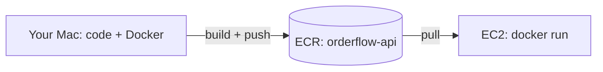

# Part 2 — From source code to a running container on EC2

The image is built where the code is, stored in ECR, and pulled by EC2. Right now the code is on your Mac; later a CI pipeline takes that job. EC2 never builds: its role may only pull from ECR, so a compromised server cannot push a poisoned image.



## 1. Build and push the image

Run this in Terminal **on your Mac**, not inside a Session Manager shell. Docker Desktop must be running (whale icon in the menu bar, *Engine running*).

```bash
cd orderflow-aws-devops
git switch main && git status --short        # empty output = no uncommitted changes
export AWS_PROFILE=orderflow-lab AWS_DEFAULT_REGION=us-east-2 AWS_PAGER=""
ACCOUNT_ID=$(aws sts get-caller-identity --query Account --output text)
REGISTRY=$ACCOUNT_ID.dkr.ecr.us-east-2.amazonaws.com
TAG=$(git rev-parse --short HEAD) && echo $TAG
aws ecr get-login-password | docker login --username AWS --password-stdin $REGISTRY
docker buildx build --platform linux/amd64 -t $REGISTRY/orderflow-api:$TAG --push .
aws ecr describe-images --repository-name orderflow-api \
  --query 'imageDetails[].[imageTags[0],imageDigest]' --output text
```

What each part is for:

- `get-login-password | docker login --password-stdin`: the ECR password is a token valid for 12 hours. Piping it keeps it off the screen and out of shell history.
- `--platform linux/amd64`: Apple silicon Macs are arm64, the `t3.medium` is x86_64 (`amd64` is another name for it). An image built for the wrong chip fails on EC2 with `exec format error`.
- Tag = short Git SHA: the repository uses immutable tags, so a tag can never be overwritten. One tag means one build, and you always know which commit is running.
- `--push`: send the result straight to ECR instead of keeping it on the Mac.

The first build downloads the Node base image and took about two minutes here. Expected end of the output:

```
=> => pushing manifest for <ACCOUNT_ID>.dkr.ecr.us-east-2.amazonaws.com/orderflow-api:7ded466@sha256:05c7…
None     sha256:e241cb2c…   # the linux/amd64 image
None     sha256:b2e21a1c…   # build attestation (provenance)
7ded466  sha256:05c7fdef…   # image index: the tag points here
```

Three rows for one push is normal. Buildx attaches a provenance attestation by default, so the tag points to an index that lists the real image and the attestation. The two untagged rows belong to the tagged one; they are not leftovers and must not be deleted.

## 2. Run it on EC2

Not done yet.

## When something goes wrong

| You see | Cause | Do |
| --- | --- | --- |
| `failed to connect to the docker API at unix:///Users/<you>/.docker/run/docker.sock` | Docker Desktop is not running | Open Docker Desktop, wait for *Engine running*, run the build again |
| `Login Succeeded`, then the error above | Login only talks to ECR; building needs the local engine | Same as above |
| `exec format error` when the container starts on EC2 | Image built for arm64 | Rebuild with `--platform linux/amd64` |
| `tag invalid ... already exists` | Immutable tag pushed before | Commit the change and push under the new SHA; never reuse a tag |
| `denied ... not authorized to perform ecr:...` | Operator user lacks push permission | Add the missing ECR action to the deploy policy |
| `Your authorization token has expired` | ECR login older than 12 hours | Run the `docker login` line again |
